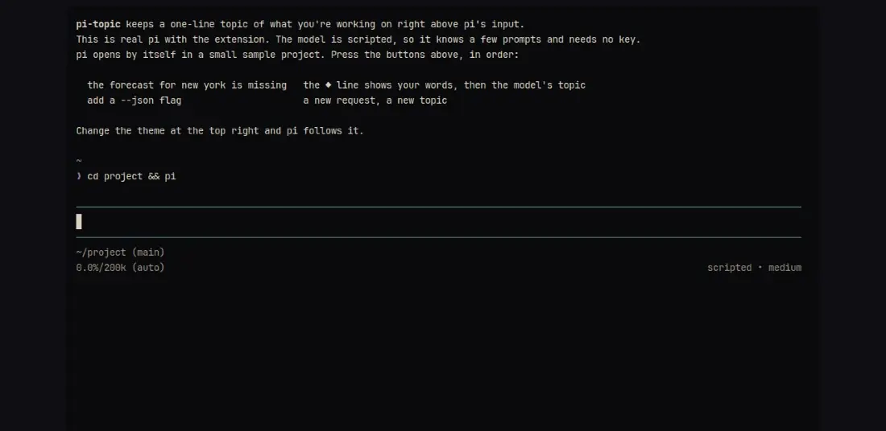

# pi-topic

A one-line topic of what you're working on, kept right above [pi](https://pi.dev)'s input.

**[Try it in your browser](https://pi-topic.soleone.xyz)**: real pi with the extension, on a scripted model, so no key and nothing leaves the page.



Each request shows its own first line on the ◆ line right away, then pi's current model sums up the session as a short topic in the background. The topic stays put while the agent reads, edits and runs tools, so a glance at the pane tells you what it is doing. It is the same idea as pi-herdr-tabs, without a tab title's 24-character limit.

## Install

```bash
pi install git:github.com/Soleone/pi-topic
```

Or for one pi process: `pi -e ./src/index.ts` from a checkout.

## How it works

- On each user request (`before_agent_start`), a deterministic fallback topic
  derived from the prompt's first line appears immediately.
- In parallel, a bounded background request (15 s timeout, 1024 output tokens)
  asks Pi's currently selected model for a refined topic using the prompt plus
  a compact excerpt of the session context.
- Once set, the topic stays stable across turns and tool executions. A late
  refinement from an older request never overwrites a newer one.
- A new user request can establish a new topic; slash commands do not.
- The widget is cleared on session start and shutdown so stale topics never
  leak between sessions.

Topics are sanitized (escape sequences, URLs, credentials, and filesystem
paths are stripped) and capped at 140 Unicode code points of stored content,
which is sized so a full topic fits a single terminal line without wrapping;
rendering additionally truncates to the live terminal width with an ellipsis
as a safety net.

## Development

```bash
npm install
npm run check
npm test
npm run demo            # the browser demo at http://localhost:4321
npm run media:capture   # re-record demo/media (needs agent-browser and FFmpeg)
```

When editing an auto-discovered copy, run `/reload` in the Pi pane or restart
Pi before testing.

## Configuration

| Variable | Purpose |
| --- | --- |
| `PI_TOPIC_DEBUG=1` | Log short, sanitized topic-request failure messages. |

## Relationship to pi-herdr-tabs

pi-topic is standalone: no Herdr CLI, no `HERDR_*` variables, no crash-recovery
state file, and no label restoration on shutdown - the widget lives entirely
inside the Pi TUI. The two extensions can run side by side, or pi-topic can
replace pi-herdr-tabs if the tab title is no longer needed.

## Manual smoke test

1. Load with `pi -e ./src/index.ts`.
2. Submit `Fix the auth refresh bug` and confirm a `◆ Fix the auth refresh bug`
   line appears above the input immediately, then gets refined by the model.
3. Run a task that reads, searches, edits, and tests files, and confirm the
   topic stays put throughout.
4. Start a second user request and confirm the topic updates.
5. Narrow the terminal and confirm the topic truncates instead of wrapping.
